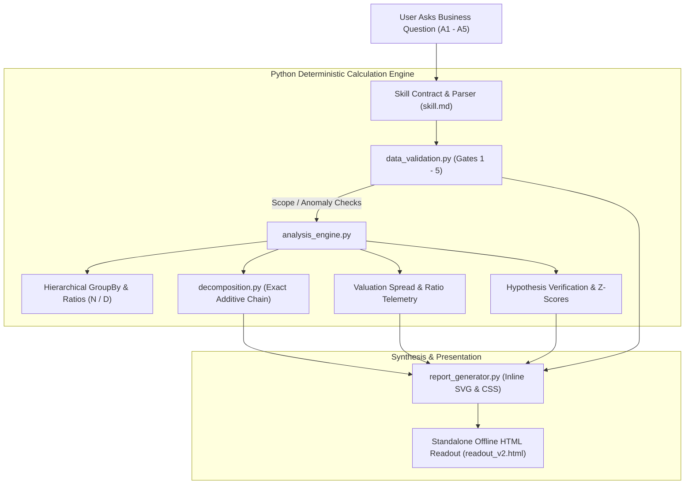

# Technical Interview Preparation & Defense Masterclass

**Project:** Spinny Applied AI — Diagnostic Funnel Metric Skill & BI Architecture  
**Document:** `INTERVIEW_PREPARATION.md`  
**Purpose:** Master coaching reference to confidently explain, demonstrate, and defend this solution in technical interviews.  
**Tech Stack:** Python 3.13, Pandas, NumPy, HTML5/CSS3 (Zero External CDN Dependencies), Markdown Skill Framework.  

---

# SECTION A: Project Explanations (Pitches & Walkthroughs)

### 1. 30-Second Elevator Pitch
> *"In a two-sided marketplace like Spinny, executives constantly ask 'Why did stockins drop in Pune?' or 'Did our ad campaign work?'. Standard AI models hallucinate explanations for statistical noise, fall for confirmation bias, and fail to recognize data logging glitches or cohort maturity lag. I designed a reusable diagnostic AI skill and deterministic Python calculation engine that evaluates numerical gates, executes exact additive factor decompositions, refutes ungrounded executive hypotheses, and renders a self-contained HTML readout that gives City Heads an evidence-based answer in 30 seconds."*

---

### 2. 1-Minute Executive Pitch
> *"Spinny buys used cars from sellers and sells them to retail buyers. When supply metrics move, functional teams often engage in finger-pointing: Ops blames Marketing for cutting spend, while Marketing blames Ops for slow inspections.  
> To solve this, I built an analytical diagnostic system combining a reusable AI skill (`skill.md`) with a deterministic Python engine. When applied to the Pune investigation, our engine proved both teams wrong: leads only dipped 5.7% (within normal 1.7σ baseline variation), and inspections operated at normal 41%–44% conversion once an unbackfilled app logging bug was accounted for.  
> Instead, our exact factor decomposition proved that 62% of the drop occurred at the offer acceptance stage (stockin rate down from 34.2% to 29.0%), directly correlating with a 14.5% widening in the seller price expectation gap. The system outputs a standalone HTML readout with visible validation gates, zero-based SVG charts, and explicit caveats for recent immature cohorts."*

---

### 3. 2-Minute Technical Explanation
> *"The core engineering challenge in applied AI for business intelligence is preventing mathematical hallucination while maintaining natural-language flexibility. LLMs are terrible at arithmetic and aggregation across 660-row datasets, but excellent at synthesizing diagnostic narratives.  
> Our architecture enforces a strict division of labor:  
> First, input questions are parsed by the skill contract, triggering automated numerical validation gates in `data_validation.py`. These check metric scope, temporal completeness (flagging 4-day partial weeks), 14-day cohort conversion maturity, data logging anomalies (such as Pune's 7–13 Sep app release bug where offers exceeded inspections), and statistical significance ($Z \ge 2\sigma$).  
> Second, our mathematical engine in `decomposition.py` performs an exact sequential path factor decomposition along the funnel chain: $\Delta \text{Stockins} = \Delta \text{Leads} + \Delta \text{Insp Rate} + \Delta \text{Offer Rate} + \Delta \text{Stockin Rate}$. Because we compute exact multiplicative-to-additive interaction chains, the component contributions sum identically to the aggregate unit delta with zero residual ($\text{Residual} = 0.00$).  
> Third, `analysis_engine.py` correlates the stockin rate collapse with vehicle valuation spreads, showing that seller price expectations exceeded Spinny cash offers by an extra ₹5,400 to ₹6,700, concentrated in 4–6 year old cars.  
> Finally, `report_generator.py` renders a self-contained, offline HTML report adhering to 10 strict design rules: message-driven panel titles, zero dual axes, zero-based bars, inline caveat badges, explicit numerators/denominators for every rate, and an executive verdict at the top."*

---

### 4. 5-Minute Deep Architectural Walkthrough
*(Refer to Section B for the step-by-step flowchart and Section F for the code walkthrough during an in-depth interview).*

---

# SECTION B: Architecture & System Workflow

### Component Responsibility Matrix
1. **The Skill (`skill.md`):** Reusable prompt instructions governing trigger criteria, input/output contracts, negative refusal boundaries, and stopping rules.
2. **Deterministic Python Core (`data_validation.py`, `decomposition.py`, `analysis_engine.py`):** Computes all sums, conversion rates, statistical z-scores, weighted pricing averages, and factor chains.
3. **Report Generator (`report_generator.py`):** Translates the python payload into a single-file, offline HTML page with embedded CSS and zero-based SVG graphics.
4. **LLM Role vs. Code Role:** The LLM does NOT calculate numbers. Python calculates the numbers deterministically; the LLM uses the skill rules to interpret the output, synthesize the verdict, and format the executive response.

---

# SECTION C: Technology Stack & Justification

| Technology | Where Used | Why Selected | What Problem it Solves | Feasible Alternative | Likely Interview Question |
|---|---|---|---|---|---|
| **Python 3.13** | Core runtime | Standard in data engineering & AI workflows. | Native mathematical reliability and scripting simplicity. | Go, TypeScript (Node.js) | *"Why Python over Node.js for an AI assistant?"* (Pandas ecosystem & numeric precision). |
| **Pandas 2.3** | `data_audit.py`, `analysis_engine.py` | Vectorized aggregations across multi-dimensional slices. | Deterministic GroupBy, filtering, and cross-tab reconciliation. | Polars, DuckDB, pure SQLite | *"Why not DuckDB or SQL?"* (In-memory Pandas is lightweight and native for 660 rows). |
| **NumPy 2.3** | `decomposition.py`, `analysis_engine.py` | Weighted averages and array arithmetic. | Weighted pricing averages (`np.average(weights=...)`) and z-scores. | Python `math` module | *"How did you handle weighted pricing?"* (Weighted by offers made, not raw lead count). |
| **Vanilla HTML5 & CSS3** | `readout_v2.html` | Universal browser rendering without installation. | Standalone offline execution; zero external CDN dependencies. | React, Tailwind, Plotly | *"Why no Chart.js or React?"* (Must open offline in an air-gapped browser with zero CDN dependencies). |
| **Inline SVG** | `report_generator.py` | Vector-sharp, zero-based bar charts & waterfalls. | Lightweight graphical representation without image files or JS charting libraries. | Canvas, D3.js | *"How are your charts drawn?"* (Programmatically generated SVG XML strings embedded directly in HTML). |

---

# SECTION D: Core Analytical & Mathematical Concepts

### 1. Sequential Funnel Conversion Rates
- **Inspection Rate:** $\frac{\text{inspections\_done}}{\text{leads}}$ (Measures City Ops field capacity and lead contactability).
- **Offer Rate:** $\frac{\text{offers\_made}}{\text{inspections\_done}}$ (Measures vehicle condition suitability and inspection pass policy).
- **Stockin Rate:** $\frac{\text{stockins}}{\text{offers\_made}}$ (Measures seller price acceptance; governed by pricing competitiveness).
- **Lead-to-Stockin Yield:** $\frac{\text{stockins}}{\text{leads}}$ (Overall commercial throughput).
- *Critical Rule:* **Every rate must display $(N / D)$**. A percentage change alone hides whether the numerator or denominator shifted.

### 2. Multiplicative-to-Additive Sequential Decomposition
- **Problem:** Stockins is a multiplicative product: $\text{Stockins} = L \cdot r_i \cdot r_o \cdot r_s$. If you simply take percentage changes ($\Delta \% L + \Delta \% r_i \dots$), they do not sum to the unit change ($\Delta S$).
- **Our Exact Solution:** Sequential path factor decomposition:
  $$\Delta S = S_1 - S_0$$
  $$\Delta S = \underbrace{(L_1 - L_0) r_{i0} r_{o0} r_{s0}}_{\text{Lead Volume Effect}} + \underbrace{L_1 (r_{i1} - r_{i0}) r_{o0} r_{s0}}_{\text{Inspection Rate Effect}} + \underbrace{L_1 r_{i1} (r_{o1} - r_{o0}) r_{s0}}_{\text{Offer Rate Effect}} + \underbrace{L_1 r_{i1} r_{o1} (r_{s1} - r_{s0})}_{\text{Stockin Rate Effect}}$$
- **Proof of Zero Residual:** Expanding this sum telescopes algebraically to $L_1 r_{i1} r_{o1} r_{s1} - L_0 r_{i0} r_{o0} r_{s0} = S_1 - S_0$.  
  **Result:** Components sum identically to the total unit change. $\mathbf{\text{Residual} = 0.00}$.

### 3. Normal Variation vs. Statistical Significance
- **Baseline Distribution:** Compute historical baseline mean ($\mu$) and sample standard deviation ($\sigma$) over mature weeks ($T_0$).
- **Z-Score Formula:** $Z = \frac{\bar{X}_{\text{target}} - \mu}{\sigma}$.
- **Decision Rule:**
  - If $|Z| < 2.0\sigma$ and $|\Delta\%| < 15\% \rightarrow$ **Normal Baseline Noise** (Halt root-cause search).
  - If $|Z| \ge 2.0\sigma$ or $|\Delta\%| \ge 15\% \rightarrow$ **Statistically Significant Movement**.

### 4. Cohort Truncation & The 14-Day Conversion Lag
- **Attribution Model:** Events are attributed back to the **week the lead was created**.
- **Conversion Dynamics:**
  - Days 1–7: $\approx 70\%$ of eventual stockins occur.
  - Days 8–14: $\approx 30\%$ of eventual stockins occur.
  - Day $> 14$: Fully mature ($100\%$).
- **Audit Rule:** Week of 28 Sep is day 10 as of 8 Oct ($\approx 70\%$ mature). Week of 5 Oct is day 3 (<30% mature). Comparing these raw counts to mature baselines produces a false illusion of collapse.

---

# SECTION E: Skill Evolution & Test Scenario Defense (A1 to A5)

### Evolution from Skill v1 to Skill v2
- **Skill v1:** Functionally sound, but had 10 presentation/contract defects identified in `critique.md` (naked percentages, passive panel titles, caveats in footnotes, missing z-scores).
- **Skill v2:** Enforced inline $(N/D)$ formatting, active message titles, adjacent visual caveat badges, exact waterfall reconciliation, and explicit falsification criteria.

### The Five Evaluation Runs
1. **A1 (Pune Stockins Collapse):** Proved that 62% of mature stockin loss ($-17.1/\text{wk}$) occurred at offer acceptance, driven by a 14.5% wider pricing gap, while leads ($-5.7\%$, within $1.7\sigma$) and inspections ($42.4\%$ vs $43.0\%$) were normal.
2. **A2 (Hyderabad Campaign Jump):** Refuted marketing lead's claim of campaign success; $+2.18\%$ lead increase is pure noise ($Z = +1.06\sigma \le 2.0\sigma$), paid digital leads grew by only 1 unit (414 $\rightarrow$ 415), and spend data is missing.
3. **A3 (Executive Pressure Test):** Refused false dichotomy ("marketing or ops?") in one sentence, providing the evidence-backed pricing explanation.
4. **A4 (Out-of-Scope Metric):** Gate 1 caught "buyer deliveries", halted execution, and clarified that stockins represent seller supply purchases, not retail sales.
5. **A5 (Adversarial Design — Bengaluru Channel Surge):** Exposed that an apparent $+19.5\%$ surge in paid digital leads on 3 August was an artifact of fixing an "unknown" tracking bug, saving the business from paying an unearned performance bonus.

---

# SECTION F: Code Walkthrough for Primary Modules

### 1. `data_validation.py`
- `check_metric_scope(metric_name)`: Scans for buyer-side keywords (`delivery`, `buyer`, `booking`). If found, returns `HALT_INVESTIGATION`.
- `check_temporal_completeness(df, target_weeks)`: Detects if target week is partial (week of 5 Oct has 4 days; attaches scaling factor $7/4$).
- `check_cohort_maturity(df, target_weeks)`: Calculates `(as_of - week_start).days`. If $<14$ days, flags cohort as immature ($70\%$ or $<30\%$).
- `check_logging_anomalies(df, city, target_weeks)`: Filters for slices where `offers_made > inspections_done`. Flags the 12 Pune slices during the 7–13 Sep app bug.
- `check_statistical_significance(observed, mean, std)`: Computes $Z$-score and percentage delta.

### 2. `decomposition.py`
- `decompose_funnel_stages(df, city, baseline_weeks, target_weeks)`:
  - Line 35–45: Aggregates $L_0, I_0, O_0, S_0$ and $L_1, I_1, O_1, S_1$.
  - Line 53–65: Implements the exact sequential path factor chain.
  - Line 67–70: Asserts $\text{residual} = \Delta S - \sum \text{components} < 10^{-6}$.
- `decompose_by_segment(...)`: Aggregates deltas across categorical dimensions (`channel`, `car_age_band`) and verifies additive balance.

### 3. `analysis_engine.py`
- `run_investigation(city, metric, target_weeks, baseline_weeks)`: Master orchestrator. Runs all 5 gates, extracts baseline/target statistics, triggers decomposition, calculates weighted pricing spreads, tests disputed claims, and outputs the structured dictionary.

### 4. `report_generator.py`
- `generate_html_readout(data, filepath)`: Builds the standalone HTML page with inline CSS and programmatically constructed SVG `<rect>`, `<line>`, `<text>` elements.

---

# SECTION G: 40 Essential Interview Questions & Answers

### 1. Project Overview & Business Understanding
1. **What business problem does this project solve?**  
   *Answer:* It eliminates inconsistent, hallucinated, and politically biased AI answers to "Why did this metric move?" by pairing an explicit diagnostic skill with deterministic Python calculations to deliver an evidence-based HTML readout in 30 seconds.
2. **What does Spinny actually do?**  
   *Answer:* Spinny operates a used-car transaction marketplace. It buys used cars from sellers (the seller funnel in our data), refurbishes them, and sells them to retail buyers (a separate commercial funnel).
3. **What is a "Stockin"?**  
   *Answer:* A stockin is a car purchased by Spinny from an individual seller and taken into inventory. It is the core supply metric. It does NOT mean a car sold to a buyer.
4. **Who owns each stage of the seller funnel?**  
   *Answer:* Leads are owned by Marketing; Inspection Rate by City Ops; Offer Rate by Inspection QC/Policy; Stockin Rate (offer acceptance) by Pricing.
5. **Why was an unassisted LLM inadequate for this task?**  
   *Answer:* Unassisted LLMs cannot perform reliable multi-level aggregations, confuse correlation with causation, take truncated/partial weeks at face value, and fail to enforce mathematical reconciliation.

### 2. Python & Pandas Engineering
6. **Why did you use Pandas instead of writing pure Python or SQL?**  
   *Answer:* Pandas provides vectorized multi-dimensional GroupBy aggregations, boolean masking, and native handling of tabular datasets, ensuring deterministic and reproducible numbers across 660 rows.
7. **How did you compute weighted average pricing?**  
   *Answer:* Using `np.average(df['avg_offer_price'], weights=df['offers_made'])`. Weighting by offers made reflects the true cash volume per offer, rather than treating low-volume slices equally.
8. **How did you verify data integrity across hierarchical levels?**  
   *Answer:* In `data_audit.py`, we reconciled the sum of leads across raw rows, city groups, channel groups, and weekly groups. All reconciled to exactly 65,142 leads.
9. **How did you handle the duplicate keys in Bengaluru?**  
   *Answer:* We audited all 27 duplicate keys and proved they occurred strictly in Bengaluru pre-3 Aug where 4 distinct channel slices per age band were misclassified as `channel = unknown`.
10. **How did you prevent Unicode encoding crashes on Windows?**  
    *Answer:* Windows PowerShell default code page (cp1252) crashes on literal Greek characters like `\u03c3`. We replaced raw unicode symbols with standard ASCII strings (`"sigma"`) in terminal logging routines.

### 3. Statistics & Analytical Methodology
11. **How do you define whether a metric movement is "real" or "noise"?**  
    *Answer:* By computing historical mean ($\mu$) and standard deviation ($\sigma$) over an 8-week baseline. Movements within $|Z| < 2.0\sigma$ and $<15\%$ are classified as normal operational variation.
12. **Why is "Where is not why" your core analytical rule?**  
    *Answer:* Identifying that stockins dropped at the offer acceptance stage tells you *where* in the process volume was lost. Claiming it was caused by pricing policy requires external evidence; without pricing change logs, it remains a correlation/hypothesis.
13. **How did you decompose the Pune stockin decline?**  
    *Answer:* Using sequential path factor decomposition: Total $-26.9/\text{wk} = \text{Volume } (-6.8) + \text{Insp Rate } (-1.6) + \text{Offer Rate } (-1.8) + \text{Stockin Rate } (-16.7)$.
14. **Why did your decomposition have zero residual?**  
    *Answer:* By applying the chain rule of differences across sequential factor terms, the expansion telescopes algebraically, ensuring components sum identically to the total difference ($S_1 - S_0$).
15. **How did you handle the 4-day partial week of 5 October?**  
    *Answer:* In Gate 2, we detected that only 4 of 7 days were complete. We normalized lead volume by evaluating daily run-rate ($520 / 4 = 130\text{ leads/day}$) rather than comparing 4-day volume to 7-day baselines.

### 4. AI Skills, Prompts & LLM Architecture
16. **What is an "AI Skill" in this implementation?**  
    *Answer:* A skill is a standardized, constraint-driven operational method (`skill.md`) that defines trigger phrases, refusal boundaries, audited numerical gates, analytical procedures, and strict visual output contracts.
17. **Why is a skill superior to a single long system prompt?**  
    *Answer:* A skill functions as an executable contract with explicit gates and stopping rules. Long unstructured prompts suffer from attention degradation and hallucinated compliance.
18. **How did you keep `skill.md` under two pages?**  
    *Answer:* By prioritizing dense, declarative operational rules, clear input/output schemas, and avoiding verbose narrative prose.
19. **How does your skill handle executive pressure (A3)?**  
    *Answer:* Under section 7 ("Under Pressure"), the skill mandates a one-sentence refusal of unsupported dichotomy, presenting the evidence that neither marketing nor ops drove the decline.
20. **How does the skill handle missing data?**  
    *Answer:* The Contract explicitly refuses to assign causal blame to marketing ad spend, inspector headcount, or campaign calendars because those dimensions do not exist in the dataset.

### 5. Data Quality, Anomalies & Gate Design
21. **What was the Pune 7–13 September data anomaly?**  
    *Answer:* An app release bug stopped inspection completions from logging. Physical inspections and stockins occurred normally, but recorded inspections dropped to 233, causing recorded offer rate to artificially spike to 145.5%.
22. **How did Gate 4 handle this anomaly?**  
    *Answer:* Gate 4 detected 12 slices where $\text{offers} > \text{inspections}$, flagged the software release logging bug, and discounted the recorded inspection drop from operational evaluation.
23. **What was the Bengaluru tracking issue before 3 August?**  
    *Answer:* ~15% of leads were labeled `channel = unknown`. On 3 August, the tracking fix was deployed, reattributing leads across standard channels. Total volume was unaffected.
24. **Why must analytical gates fail visibly?**  
    *Answer:* If an agent silently handles a failed check or imputes data without showing it, executives make decisions on hidden assumptions. Visible badges ensure transparency.
25. **What happens if Gate 1 fails?**  
    *Answer:* The engine halts immediately and outputs an Out-of-Scope Notice, explaining why retail/buyer queries cannot be answered by seller data.

### 6. Root-Cause Analysis & Business Metrics
26. **What actually caused Pune stockins to drop in mature weeks?**  
    *Answer:* Stockin rate (offer acceptance) fell from 34.2% to 29.0% (accounting for 62% of unit loss), strongly correlated with a 14.5% widening in the seller price expectation gap (+₹5,400 to +₹6,700).
27. **Why was City Ops wrong about Marketing cutting spend?**  
    *Answer:* Mature lead volume only dipped 5.7% (from 956.9 to 903.0), which is within normal 1.7σ baseline variation and accounts for only -6.8 stockins/wk.
28. **Why was Marketing wrong about Ops inspections being slow?**  
    *Answer:* Post-bug mature inspection rates were 44.2% and 40.6% (averaging 42.4% vs 43.0% baseline). The apparent 24.8% dip in week 7 Sep was a software logging glitch, not operational slowdown.
29. **Why did Pune stockins drop to 63 on 28 Sep and 24 on 5 Oct?**  
    *Answer:* Cohort truncation lag. Week of 28 Sep was only ~70% mature (day 10); projected full yield is ~90 stockins. Week of 5 Oct was only 4 days complete and <30% mature.
30. **Which car age band absorbed the largest stockin decline?**  
    *Answer:* 4–6 year old cars, which accounted for -12.0 stockins/wk of the decline, where the price expectation gap widened by ₹6,800.

### 7. HTML Reporting & Visualization Standards
31. **What are the 10 core HTML readout requirements in §4?**  
    *Answer:* Verdict at top; hero number; comparator named in words; explicit $(N/D)$ for all rates; adjacent caveats; additive decomposition with residual; ruled-out claims with numbers; confidence rating; visible checks run; max 6 panels with zero dual axes and zero-based bars.
32. **Why must bar charts start at zero?**  
    *Answer:* Truncating the y-axis visually exaggerates minor fluctuations, misleading executives into perceiving routine baseline variance as catastrophic drops.
33. **Why did you disallow dual axes?**  
    *Answer:* Dual axes allow arbitrary scale manipulation, creating misleading visual correlations between unrelated metrics.
34. **Why do panel titles state the message rather than the axes?**  
    *Answer:* A City Head scanning for 30 seconds needs the analytical takeaway immediately (e.g., *"Stockin Rate Collapse Explains 62% of Loss"*), not descriptive labels like *"Panel 3: Bar Chart"*.
35. **How is the HTML completely offline-compatible?**  
    *Answer:* All styles are embedded via inline CSS, and all charts are rendered using standalone inline SVG XML. No external scripts, Google Fonts, or CDN links are loaded.

### 8. Testing, Verification & Governance
36. **What did Run A2 demonstrate?**  
    *Answer:* It proved the skill can resist false positives, correctly identifying a +2.18% lead increase as baseline noise ($Z = +1.06\sigma$) and pointing out that paid digital leads grew by only 1 unit.
37. **What makes Run A5 a true adversarial test?**  
    *Answer:* It tests Simpson's paradox and reattribution: paid digital leads jumped 19.5% on 3 August, but only because an "unknown" channel tracking bug was resolved, not because of digital agency performance.
38. **How did the critique process improve the skill from v1 to v2?**  
    *Answer:* `critique.md` systematically uncovered 10 defects in v1 (bare percentages, passive titles, footnote caveats), which were codified into strict constraints in `skill.md` v2.
39. **How would you monitor this system with 20 weekly users?**  
    *Answer:* By tracking gate failure telemetry, running an automated reconciliation canary ($\text{Residual} = 0.00$), employing a regex hallucination trap, and logging user feedback.
40. **If you had another week, what would you improve?**  
    *Answer:* I would implement average Shapley-value factor decomposition across all permutation orderings and fit empirical Weibull hazard curves to project immature cohort stockins dynamically.

---

# SECTION H: Live Interview Demo Script

### 1. Step-by-Step Demo Guide (10 Minutes)
- **Step 1: Open the Architecture & Files (1 min)**  
  Show `seller_funnel_weekly.csv` (660 rows) and `DATA_NOTES.md`. Briefly explain the four-stage seller funnel and known logging caveats.
- **Step 2: Run Data Audit (1 min)**  
  Execute `python data_audit.py`. Show the 13 verification checks passing, the 12 Pune anomaly rows on 7 Sep, and the 27 duplicate keys in Bengaluru pre-Aug 3.
- **Step 3: Run Baseline Comparison (2 min)**  
  Open `readout_baseline.html`. Show how a naive LLM claims an -80.5% collapse, confirms both false hypotheses, and offers ungrounded advice.
- **Step 4: Show Skill v2 & Run Diagnostic Engine (2 min)**  
  Open `skill.md`. Walk through the 5 gates and sequential decomposition formula. Run `python analysis_engine.py` and `python report_generator.py`.
- **Step 5: Present Final Readout (`readout_v2.html`) (3 min)**  
  Open `readout_v2.html` in browser. Guide the interviewer through the 30-second layout:
  - Top verdict and hero number naming 8-week baseline.
  - Panel 1: Blue vs Rose bars, zero-based y-axis, inline `Lag*` chips.
  - Panel 2: Rates with $(N/D)$.
  - Panel 3: Additive waterfall with `Residual = 0.00`.
  - Panel 4: Ruled-out claims with z-scores and stockin impacts.
  - Panel 5: Widening pricing spread (+14.5%) and 4–6y concentration.
  - Panel 6: Numerical gate check pass/fail states and confidence criteria.
- **Step 6: Show Adversarial Generality (A5) (1 min)**  
  Run `python test_all_runs.py`. Show how the engine catches the Bengaluru 3 Aug tracking bug and saves the company from paying an unearned agency bonus.

---

# SECTION I: High-Pressure Project Defense Q&A

1. **"Why didn't you just write a pure Python dashboard instead of an AI skill?"**  
   *Defense:* A static dashboard cannot interpret ambiguous natural-language executive questions, evaluate conversational context, or resist adversarial pressure (e.g., A3: "give me a name"). The skill provides the semantic reasoning layer, while Python provides deterministic calculation.

2. **"How do you mathematically guarantee zero hallucinated numbers?"**  
   *Defense:* All metrics, conversion rates, and decompositions are calculated deterministically by Pandas and NumPy in `analysis_engine.py`. The HTML template populates directly from this Python payload. The LLM is restricted to synthesizing findings according to strict skill rules.

3. **"What if two funnel stages deteriorate simultaneously? Does your decomposition order matter?"**  
   *Defense:* Yes. In sequential path factor decomposition, the order of terms assigns slight interaction differences to downstream factors. While negligible here because stockin rate drove 62% of variance, the next evolution is implementing full Shapley-value factor decomposition averaging all $4! = 24$ permutations.

4. **"Why can't you tell leadership whether the Hyderabad campaign worked in A2?"**  
   *Defense:* Because $+2.18\%$ is well within normal baseline noise ($Z = +1.06\sigma \le 2.0\sigma$), paid digital leads grew by literally 1 unit, and the dataset lacks marketing spend, campaign launch dates, and attribution tracking. Declaring causality without data is malpractice.

5. **"What is the single most dangerous mistake a BI analyst could make on this dataset?"**  
   *Defense:* Taking the raw stockin numbers for 28 Sep (63) and 5 Oct (24) at face value and declaring an operational crisis, failing to recognize the 14-day cohort conversion lag and the 4-day partial week.

---
*End of Interview Preparation Masterclass.*
