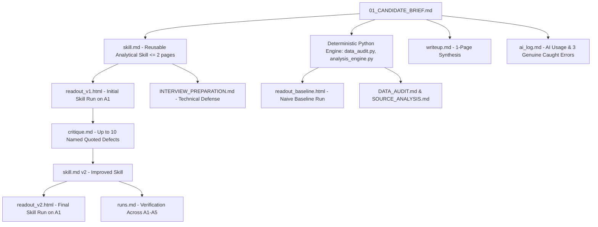

# Phase 1: Source Analysis & Business Context

**Document Status:** Complete  
**Author:** Applied AI & BI Engineering  
**Project:** Spinny Applied AI Take-Home Investigation  
**Reference Files:** `01_CANDIDATE_BRIEF.md`, `DATA_NOTES.md`, `seller_funnel_weekly.csv`  

---

## 1. Assignment Purpose & Expectations

The Spinny Applied AI take-home assignment evaluates the ability to build a **reusable analytical skill** for an AI assistant. In everyday business operations, city heads, marketing leads, and functional directors ask diagnostic questions such as:
- *"Why did this number drop?"*
- *"Is this dip real?"*
- *"What happened in Pune last week?"*

Today, standard generative LLMs without structured skills answer inconsistently:
1. They hallucinate explanations for changes that are within normal statistical variation (explaining noise).
2. They fall victim to confirmation bias by affirming the asker's preconceived hypothesis (e.g., blaming marketing if the asker suspected marketing).
3. They generate pages of generic charts without delivering a concise, evidence-based verdict.

### What the Assignment Demands
- **A General Method, Not a Pune Recipe:** A compact markdown skill (`skill.md`, maximum 2 pages) specifying triggers, contracts, rules, gates, step-by-step methods, output contracts, pressure handling, and stopping rules. It must work across any city, metric, and time period.
- **A Standardized HTML Readout:** A single, self-contained HTML page that opens offline in any browser with zero external dependencies, designed for a City Head to absorb the bottom-line verdict and supporting evidence in 30 seconds.
- **Evidence-Based Iteration:** An honest progression showing:
  - Step 1: Naive baseline without the skill (`readout_baseline.html`).
  - Step 2: Skill v1 creation.
  - Step 3: Skill v1 execution on A1 (`readout_v1.html`) and rigorous, quoted critique (`critique.md`).
  - Step 4: Skill v2 refined from the critique (`readout_v2.html`).
  - Step 5: Generality testing across 4 additional scenarios (A2, A3, A4, and an adversarial A5), documented in `runs.md`.
- **Engineering Discipline:** Deterministic Python/Pandas calculation engine for arithmetic, rates, and decompositions, paired with the LLM for structured reasoning and synthesis.

---

## 2. Business Problem & Operating Model

### What Spinny Does
Spinny is a used-car transaction platform. It operates a **two-sided marketplace**:
1. **Seller Side (Supply Acquisition):** Spinny buys used cars from individual vehicle owners who want to sell, inspects them, makes an offer, purchases the car, and adds it to inventory (**Stockin**).
2. **Buyer Side (Retail Demand):** Spinny refurbishes stocked cars, lists them online, conducts test drives, and delivers purchased cars to retail buyers.

> [!IMPORTANT]
> **Funnel Scope Boundary:**  
> The provided dataset `seller_funnel_weekly.csv` covers the **seller funnel ONLY**.  
> **A Stockin is a car purchased by Spinny from a seller.** It is the primary supply metric for each city.  
> A stockin is **not** a car sold to a buyer. Buyer-side activities (test drives, customer bookings, deliveries) are in an entirely separate funnel and are **not present** in this data.

### The Seller Funnel Mechanics
The seller journey moves through four sequential stages:

```
[Seller Lead] ──> [Inspection Done] ──> [Offer Made] ──> [Stockin (Purchase)]
   (Marketing)          (City Ops)        (Policy/QC)        (Pricing Team)
```

1. **Lead Generation:** A prospective seller submits an inquiry expressing intent to sell their car.
   - *Owner:* Marketing.
   - *Metric:* `leads` (volume segmented by channel).
2. **Inspection:** Spinny’s field inspection team visits the seller to inspect the car's condition.
   - *Owner:* City Operations.
   - *Metric:* `inspections_done`.
   - *Key Conversion Rate:* **Inspection Rate** = $\frac{\text{inspections\_done}}{\text{leads}}$.
3. **Offer Generation:** Based on vehicle condition, mileage, and market pricing algorithms, Spinny presents a formal purchase price offer.
   - *Owner:* Inspection Quality & Offer Policy.
   - *Metric:* `offers_made`.
   - *Key Conversion Rate:* **Offer Rate** = $\frac{\text{offers\_made}}{\text{inspections\_done}}$.
4. **Stockin (Transaction Close):** If the seller accepts Spinny's cash offer, the vehicle is acquired, paperwork is processed, and the car is added to Spinny’s inventory.
   - *Owner:* Pricing Team (governed by the spread between Spinny's offer price and the seller's expected price).
   - *Metric:* `stockins`.
   - *Key Conversion Rate:* **Stockin Rate** (Offer Acceptance) = $\frac{\text{stockins}}{\text{offers\_made}}$.
   - *End-to-End Yield:* **Lead-to-Stockin Rate** = $\frac{\text{stockins}}{\text{leads}}$.

---

## 3. Dataset Specification & Column Definitions

The dataset `seller_funnel_weekly.csv` comprises **660 rows** structured at a weekly grain:
$$\text{Row Granularity} = \text{week\_start} \times \text{city} \times \text{channel} \times \text{car\_age\_band}$$

| Column | Data Type | Business Meaning |
|---|---|---|
| `week_start` | Date (`YYYY-MM-DD`) | Monday of the week the seller lead was **created** |
| `city` | Categorical | Operating city: `Bengaluru`, `Delhi NCR`, `Hyderabad`, `Pune` |
| `channel` | Categorical | Lead acquisition channel: `paid_digital`, `organic`, `referral`, `partner`, (`unknown` in early Bengaluru) |
| `car_age_band` | Categorical | Vehicle age group: `0-3y`, `4-6y`, `7y+` |
| `leads` | Integer | Total seller leads created in that week |
| `inspections_done` | Integer | Of those leads, how many were physically inspected (so far) |
| `offers_made` | Integer | Of those inspected, how many received a formal purchase offer (so far) |
| `stockins` | Integer | Of those offers, how many vehicles Spinny successfully purchased (so far) |
| `avg_offer_price` | Numeric (₹) | Weighted average cash offer made by Spinny for that slice |
| `avg_expected_price`| Numeric (₹) | Weighted average price seller stated they expected for that slice |

### Temporal & Attribution Structure
- **Temporal Span:** 13 weeks starting Monday 2026-07-13 through Monday 2026-10-05.
- **Data As-Of Date:** Thursday, 8 October 2026.
- **Lead Creation Cohort Attribution:** Downstream events (`inspections_done`, `offers_made`, `stockins`) are strictly attributed back to the **week the lead was created**, not the week the inspection or stockin occurred.
- **Conversion Latency Window:**
  - A lead can take up to **14 days** to progress through inspection, offer, and stockin.
  - Historical conversion benchmark: **~70% of eventual stockins occur within the first 7 days**; the remaining **~30% convert in days 8–14**.
  - **Cohort Immaturity Implications:**
    - The week of `2026-09-28` is only ~70% mature (day 10 as of 8 Oct).
    - The week of `2026-10-05` has only 4 days of lead creation and less than 30% of its ultimate conversion completed.

---

## 4. Known Data Caveats & Systemic Issues

`DATA_NOTES.md` documents specific real-world anomalies that any valid analysis must account for:

1. **Pune App Release Logging Bug (7–13 Sep 2026):**
   - An app release disrupted the logging of inspection completions in Pune for the week of `2026-09-07`.
   - **Ground truth:** Physical inspections occurred at normal historical operational velocity; offers and stockins were logged properly.
   - **Data artifact:** The logged `inspections_done` count in Pune dropped drastically. Because offers were logged correctly while inspections were under-logged, the observed offer rate $\frac{\text{offers\_made}}{\text{inspections\_done}}$ artificially spiked (in several slices exceeding 100%).
   - **Resolution:** The bug was patched on 14 September 2026, but historical records were **never backfilled**.
   - **Analytical mandate:** Any report on Pune must flag this artifact and avoid attributing the low recorded inspection count to operational failure.

2. **Bengaluru Channel Attribution Tracking Change (Before 3 Aug 2026):**
   - Prior to `2026-08-03`, a tracking implementation defect resulted in ~15% of Bengaluru leads being assigned to `channel = unknown`.
   - **Ground truth:** Total city lead volume and downstream counts are completely accurate.
   - **Analytical mandate:** Channel mix comparisons in Bengaluru crossing the 3 August threshold are distorted; channel-level shifts must carry an explicit caveat.

3. **Incomplete Calendar Week (Week of 5 Oct 2026):**
   - The data is current as of Thursday 8 October 2026. The week starting Monday 5 October contains only **4 out of 7 operating days**.
   - **Analytical mandate:** Absolute lead volume cannot be compared directly against prior 7-day weeks. Analysis must use daily run-rates ($\text{leads} / 4$) or pro-rate by $\times \frac{7}{4}$.

4. **Missing Business Dimensions (Omitted Evidence):**
   - The dataset contains **no marketing spend data**, no campaign launch/end schedules, no pricing policy change logs, and no inspector headcount figures.
   - **Analytical mandate:** The skill must strictly refuse to attribute causal responsibility to marketing spend, ad campaigns, or headcount changes based on this dataset alone.

---

## 5. Required Submission Deliverables

The official brief mandates the following core deliverables:



| Item | File Name | Required Standard |
|---|---|---|
| 1 | `skill.md` | General diagnostic method, $\le$ 2 pages, structured sections (Trigger, Contract, Rules, Gates, Method, Output, Defaults, Under Pressure, Stopping Rule). |
| 2 | `readout_baseline.html` | Naive execution of A1 without the skill. Demonstrates unassisted LLM failure modes. |
| 3 | `readout_v1.html` | Execution of A1 using skill v1. Completely unedited raw output. |
| 4 | `critique.md` | Up to 10 specific, quoted defects against §4 readout requirements; specifies category and exact remedy. |
| 5 | `readout_v2.html` | Re-run of A1 using improved skill v2. Must fix all identified defects. |
| 6 | `runs.md` | Complete log of A1 (baseline, v1, v2) and test scenarios A2, A3, A4, A5 with inputs, outputs, and verdicts. |
| 7 | `writeup.md` | Maximum 1 page: improvements over baseline, 3 key design decisions, deliberate omissions, monitoring 20 weekly users. |
| 8 | `ai_log.md` | Authentic log of AI tools, Python collaboration, and 3 specific instances where AI was wrong/misleading and was corrected. |
| 9 | `INTERVIEW_PREPARATION.md` | Comprehensive coaching manual: pitches, technical architecture, deep mathematical concepts, code walkthrough, 40+ Q&A bank, live demo script. |

---

## 6. Explicitly Required vs. Deliberately Omitted

### Explicitly Required
- **Strict Readout Contract (§4):**
  1. Top-line answer: 1 verdict sentence + 1 hero number.
  2. Every number explicitly names its comparator in words (e.g., `"vs 8-week baseline"`).
  3. Every conversion rate shows both numerator and denominator (e.g., `42.1% (380 / 902)`).
  4. Caveats sit adjacent to the affected metric.
  5. Additive decomposition reconciles exactly or reports an explicit residual.
  6. Ruled-out explanations backed by numerical evidence.
  7. Confidence rating with explicit conditions that would alter it.
  8. Audited gate checks with pass/fail criteria and numbers.
  9. Explicit "Data as of" timestamp.
  10. Visual layout: Max 6 panels, zero dual axes, zero-based bar charts, message-driven panel titles.
- **Analytical Generality:** Skill must answer for any metric, any city, any period.
- **Evidence-Based Boundaries:** Distinguish *where* a drop occurred from *why* it occurred. Do not assign blame without external data.

### Deliberately Omitted
- **No Complex Heavyweight Infrastructure:** No LangChain, LangGraph, vector databases, RAG chunking pipelines, microservices, or external database servers. The dataset is 660 rows; adding RAG or distributed frameworks adds unnecessary failure modes and obfuscates deterministic math.
- **No External Visual CDN Dependencies:** The HTML readout must be 100% self-contained with embedded CSS and SVG charts. It must render cleanly offline in an air-gapped browser.
- **No Unsupported Causal Speculation:** The system will not infer marketing efficiency or inspector productivity when the underlying data is not in the CSV.

---

## 7. Valid vs. Invalid Assumptions

### Valid & Methodologically Sound Assumptions
1. **Baseline Selection:** A 4-week or 8-week rolling historical window of mature cohorts serves as an objective reference baseline for normal variation.
2. **Normal Variation Thresholds:** Historical standard deviation ($\sigma$) or mean absolute deviation over the baseline period defines whether a movement is noise or a statistically meaningful change ($> 2\sigma$ or $> 15\%$).
3. **Partial-Week Scaling:** For lead comparisons, the 4-day week of 5 Oct 2026 can be evaluated on a daily average basis ($\text{leads} / 4$) or scaled by $\frac{7}{4} = 1.75$ for volume projections, with visible labeling.
4. **Cohort Maturity Threshold:** Cohorts created $\ge 14$ days prior to data cutoff are mature. Cohorts $< 14$ days are partially mature (70% at 7–13 days) or immature ($< 30\%$ at $< 7$ days). Downstream metrics for immature cohorts must not be compared directly against mature baselines without maturity adjustments.
5. **Pricing Spread Metric:** The gap $(\text{avg\_expected\_price} - \text{avg\_offer\_price})$ directly influences seller acceptance and stockin rates.

### Invalid & Forbidden Assumptions
1. **Assuming Stockins Mean Buyer Sales:** Stockins represent used inventory purchased from sellers. Concluding that buyer sales or deliveries dropped because stockins dropped is an analytical defect.
2. **Blaming Marketing Spend Without Spend Data:** Speculating that marketing cut budget because leads fell is an unsupported causal leap.
3. **Blaming Ops for the Pune Logging Disruption:** Claiming field inspectors slowed down during 7–13 Sep in Pune ignores the documented software logging bug.
4. **Assuming 100% Cohort Completion in Latest Weeks:** Treating conversion rates in the week of 5 Oct 2026 as true operational declines rather than cohort truncation is an analytical error.
5. **Presenting Incomplete Sums as Exact Reconciliations:** Segment contributions must algebraically sum to the aggregate delta or present an explicit residual.

---
*End of Phase 1 Source Analysis.*
